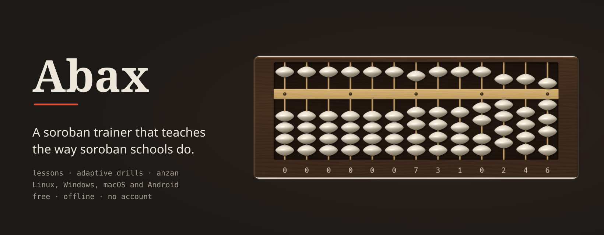
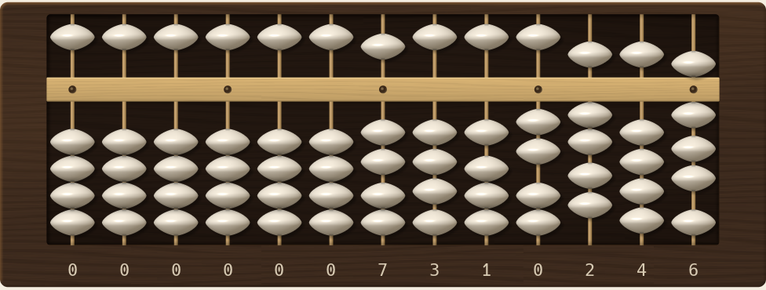
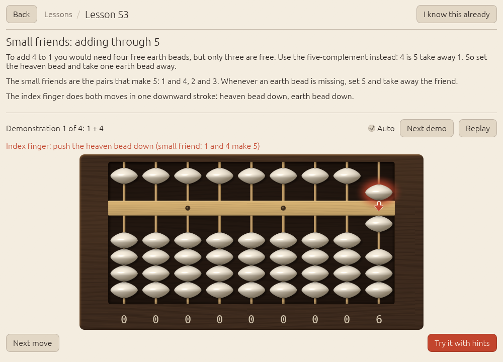
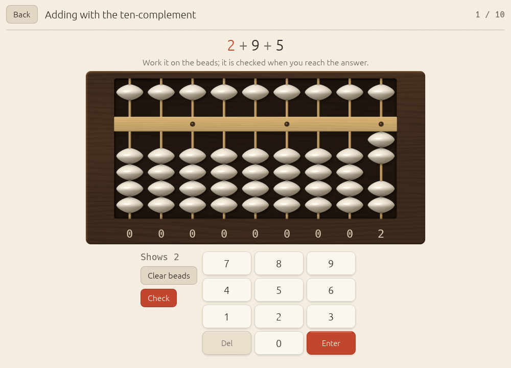
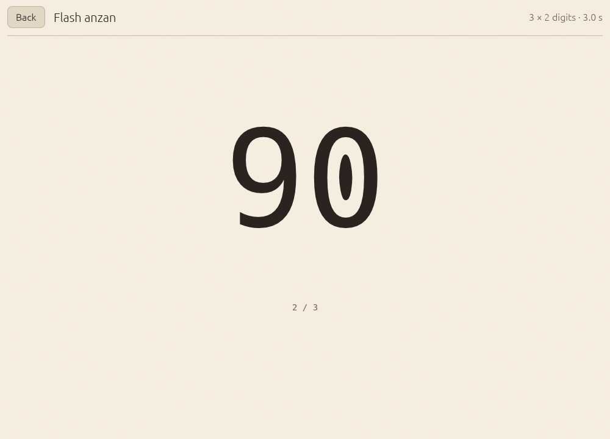
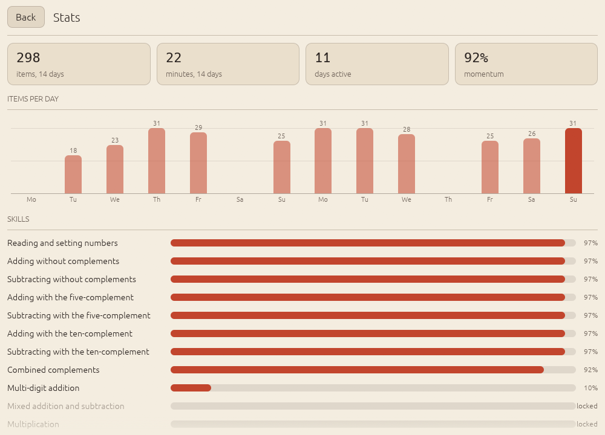

# Abax

A soroban (Japanese abacus) trainer for Linux, Windows, macOS and Android.

Abax teaches the soroban the way soroban schools do: first which finger moves which bead, and in what order, for every kind of addition and subtraction; then drills that keep each rule at the edge of what you can do; then *anzan*, where the beads fade and you calculate on a soroban you only picture. A scheduler built on Bayesian Knowledge Tracing decides what you practise next, so the sessions stay short and follow you rather than a fixed syllabus. Free, offline, no account.

## Install

Version 0.3.0. All files are on the [releases page](https://github.com/ZahakJ/abax/releases/latest), with `SHA256SUMS.txt`.

- **Linux** (x86_64, installs to `~/.local/bin`, no root):
  `curl -L https://github.com/ZahakJ/abax/releases/download/v0.3.0/abax-v0.3.0-linux-x86_64.tar.gz | tar xz && ./abax-v0.3.0-linux-x86_64/install.sh`
- **Windows** (x86_64, PowerShell):
  `iwr https://github.com/ZahakJ/abax/releases/download/v0.3.0/abax-v0.3.0-windows-x86_64.zip -OutFile abax.zip; Expand-Archive abax.zip abax`
- **macOS**: [Apple silicon dmg](https://github.com/ZahakJ/abax/releases/download/v0.3.0/abax-v0.3.0-macos-aarch64.dmg) or [Intel dmg](https://github.com/ZahakJ/abax/releases/download/v0.3.0/abax-v0.3.0-macos-x86_64.dmg); drag `Abax.app` to Applications.
- **Android** 7.0 or newer: [arm64 APK](https://github.com/ZahakJ/abax/releases/download/v0.3.0/abax-v0.3.0-android-arm64-v8a.apk) for almost every phone, or the [universal APK](https://github.com/ZahakJ/abax/releases/download/v0.3.0/abax-v0.3.0-android-universal.apk) for 32-bit phones and emulators.

The desktop builds are not code-signed with a paid certificate: Windows SmartScreen needs "More info" > "Run anyway". The macOS app is ad-hoc signed but not notarized: on the first launch right-click it > Open (macOS 15 and later: System Settings > Privacy & Security > Open Anyway), or run once `xattr -cr /Applications/Abax.app`. Android has no sound in this version. Details are in [Getting started](https://zahakj.github.io/abax/manual/getting-started.html).

## Screenshots

<table>
<tr>
<td width="50%"><picture><source media="(prefers-color-scheme: dark)" srcset="docs/screenshots/lesson-dark.png"></picture> A lesson shows each move with the finger that makes it.</td>
<td width="50%"><picture><source media="(prefers-color-scheme: dark)" srcset="docs/screenshots/drill-dark.png"></picture> Drills are worked on the beads; a wrong answer replays the correct moves.</td>
</tr>
<tr>
<td width="50%"><picture><source media="(prefers-color-scheme: dark)" srcset="docs/screenshots/flash-run-dark.png"></picture> Flash anzan: numbers flash, you give the sum.</td>
<td width="50%"><picture><source media="(prefers-color-scheme: dark)" srcset="docs/screenshots/stats-dark.png"></picture> Momentum over 14 days instead of a streak, and mastery per skill.</td>
</tr>
</table>

## What it teaches

Fifteen skills, all open from the start: take the lessons in any order and skip what you know with "I know this already". The prerequisites only suggest the next lesson. Every skill has a lesson (explanation, demonstration, guided practice) and its own ladder of drills.

| | | | |
|---|---|---|---|
| **S0** Read and set numbers | **S1** Add, no complements | **S2** Subtract, no complements | **S3** Add with the five-complement |
| **S4** Subtract with the five-complement | **S5** Add with the ten-complement | **S6** Subtract with the ten-complement | **S7** Combined complements |
| **S8** Multi-digit addition | **S9** Mixed addition and subtraction | **S10** Multiplication | **S11** Division |
| **A1** Anzan with fading beads | **A2** Flash anzan, one digit | **A3** Flash anzan, more digits | |

Every move list follows Kojima's finger-order rules. The [manual](https://zahakj.github.io/abax/manual/) explains each skill, the drills, and the scheduler with a worked example.

## Performance

Since 0.2.0 the soroban is one wgpu paint callback with per-pixel shading. 27 rods with every bead animating, release build, Linux on an RTX 4070 SUPER at 85 Hz (`ABAX_BENCH=frames=400 ABAX_WINDOW=1200x800`; average / 95th percentile; CPU time only):

| Per frame | v0.1.0 (egui polygons) | v0.2.0 (wgpu) |
|---|---|---|
| UI pass | 0.07 / 0.09 ms | 0.04 / 0.06 ms |
| CPU: UI, tessellation, paint submission | 0.38 / 0.54 ms | 0.18 / 0.23 ms |
| Frame period (display-paced) | 12.5 / 11.8 ms | 12.5 / 11.8 ms |

Method and caveats are in [Rendering](https://zahakj.github.io/abax/manual/rendering.html).

## Documentation

- Landing page: https://zahakj.github.io/abax/
- Manual: https://zahakj.github.io/abax/manual/ (source in [`docs/manual/`](docs/manual/))

## Contributing

Bug reports, curriculum corrections against the sources, and focused pull requests are welcome; see [CONTRIBUTING.md](CONTRIBUTING.md). `./verify` (formatting, clippy with warnings as errors, 115 tests, release build) must pass. The [architecture chapter](https://zahakj.github.io/abax/manual/architecture.html) shows where things live.

## Sources

The bead moves, finger order and the multiplication and division methods follow Takashi Kojima, *The Japanese Abacus: Its Use and Theory* (Tuttle, 1954); for further reading, his *Advanced Abacus: Japanese Theory and Practice* (Tuttle, 1963). Totton Heffelfinger and Gary Flom's *Abacus: Mystery of the Bead* notes informed the teaching order. The grading ladders and flash anzan speeds were checked against the exam tables of the Japan Chamber of Commerce and Industry and the Japan Abacus Federation (日商 / 日珠連), the All Japan Abacus Education Federation (全珠連, Zenshuren) and the Japan Flash Anzan Association. The scheduler uses Bayesian Knowledge Tracing (Corbett and Anderson, 1995) with an Elo-style ability estimate (Pelánek et al.). The full source lists are in [research/soroban-mechanics-and-curriculum.md](research/soroban-mechanics-and-curriculum.md) and [research/trainer-design.md](research/trainer-design.md).

## Licence

MIT, see [LICENSE](LICENSE).
