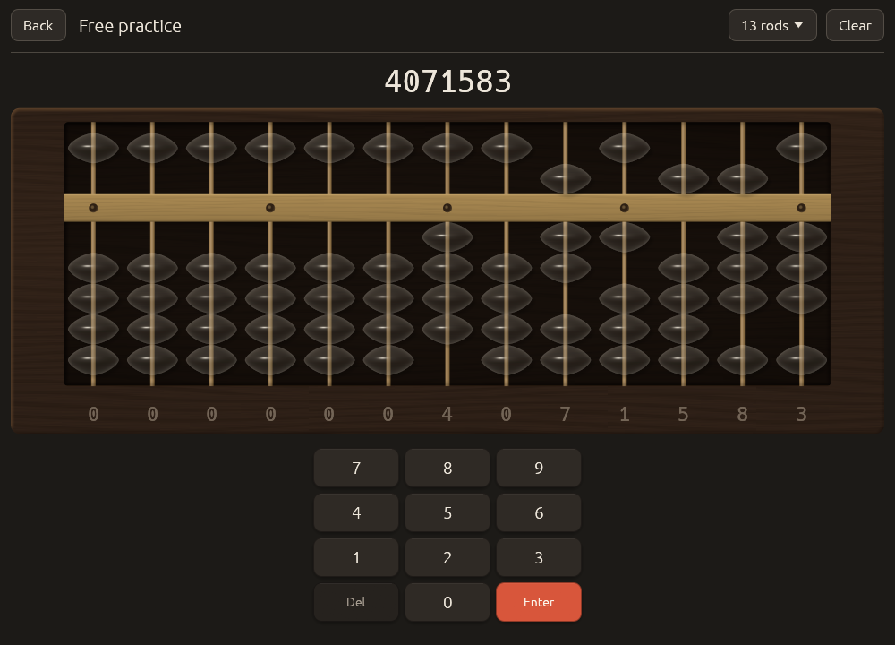

<p align="center"></p>

# Abax

Abax is a soroban (Japanese abacus) trainer for Linux, Windows, macOS and Android. It is for
anyone learning the soroban from the start, or brushing up for mental calculation: lessons show
each bead move with the finger that makes it, adaptive drills practise those moves, and anzan
fades the beads until the soroban exists only in your head.

<https://zahakj.github.io/abax/>


<p align="center">
  
  
</p>

## Features

- **Lessons that show the fingers.** Each demonstration rings the bead to move, draws its direction and names the finger ("Index finger: push the heaven bead down"), following Kojima's *The Japanese Abacus* (1954). Step through by hand, replay, then try three guided items with hints.
- **Fifteen skills, all open.** From reading numbers through the five- and ten-complements to multiplication, division and flash anzan (table below). Prerequisites suggest an order; *I know this already* skips what you can do.
- **Drills you work on the beads.** For addition and subtraction you do not type the answer: Abax follows the running total on the beads. A wrong answer replays the correct moves, in order, from where the item started.
- **A scheduler that adapts.** Bayesian Knowledge Tracing estimates whether you know each rule; an Elo rating decides when a step is too hard. *Continue* plans a session of warm-up, a focus drill on your weakest skill, and a cool-down, and brings mastered skills back for review as they fade.
- **Anzan and flash anzan.** The beads fade over 2.5 s and you finish the chain in your head; flash anzan shows numbers one at a time, from three one-digit numbers at 1.5 s each to fifteen 3-digit numbers at 0.5 s. Free flash takes your own digits, count and speed.
- **Sprint and stats.** Sixty seconds of one skill at one step; per-skill mastery, accuracy, speed and a 14-day momentum figure.
- **A soroban that looks like one.** Walnut, ebony or maple finishes, light and dark themes, 9 to 27 rods; beads answer to taps, drags, the keyboard or an on-screen keypad.

| Skill | |
| --- | --- |
| S0 | read and set numbers |
| S1, S2 | add, subtract without complements |
| S3, S4 | add, subtract with the five-complement |
| S5, S6 | add, subtract with the ten-complement |
| S7 | combined complements |
| S8, S9 | multi-digit addition, mixed chains |
| S10, S11 | multiplication, division |
| A1 | anzan with fading beads |
| A2, A3 | flash anzan |

## Install

Linux (x86_64, installs to `~/.local/bin`, no root):

```sh
curl -L https://github.com/ZahakJ/abax/releases/download/v0.3.0/abax-v0.3.0-linux-x86_64.tar.gz | tar xz && ./abax-v0.3.0-linux-x86_64/install.sh
```

Windows, macOS and Android (7.0 or newer) builds are on the
[releases page](https://github.com/ZahakJ/abax/releases/latest), with
`SHA256SUMS.txt`. The macOS app is not notarized: right-click > Open on first
launch, or run `xattr -cr /Applications/Abax.app`
([details](docs/macos-gatekeeper.md)).

From source (stable Rust; on Linux the ALSA and X11/Wayland headers listed in
[building](docs/manual/building.md)):

```sh
git clone https://github.com/ZahakJ/abax && cd abax
cargo run --release -p abax
```

## First session

On a new profile the home screen offers the first lesson, "The rods, the beam and the beads".
Press **Continue**, read the short explanation, watch the demonstrations, then **Try it with
hints** and **Start the drill** for ten recorded items. Back home, *Continue* offers the next
lesson or a planned session. Digits set the active rod, Backspace clears it, Enter checks.

Progress is one JSON file, `profile.json`, in the platform data directory (Settings > Data
shows the path). `ABAX_DATA_DIR=~/abax-test abax` runs a separate, throwaway profile.

## How it works

The workspace has two crates. `abax-core` is pure logic with no UI, I/O or randomness of its
own: the bead-move engine computes the exact move list, rule and finger order for adding or
subtracting any digit on any rod, and is tested against the complete 10 × 9 addition and
subtraction tables; the generator builds items whose moves use the skill's rule and nothing
you have not met; the scheduler holds the knowledge tracing, ability estimates, ladders and
session planner. `abax` is an egui app that runs as a binary on the desktop and as a
`NativeActivity` library on Android, so the APK needs no Java and no Gradle. Everything is
ordinary egui except the soroban, which is a single instanced wgpu draw: each bead is a
quad whose WGSL shader treats it as a solid of revolution, derives a normal from the bead's
profile and lights it, which is also how the anzan fade turns beads to glass.

## Documentation

The [manual](https://zahakj.github.io/abax/manual/) ([source](docs/manual/)):
[getting started](docs/manual/getting-started.md), [the soroban](docs/manual/soroban.md),
[finger rules](docs/manual/fingers.md), [curriculum](docs/manual/curriculum.md),
[drills](docs/manual/drills.md), [anzan](docs/manual/anzan.md),
[the scheduler, with worked numbers](docs/manual/scheduler.md),
[settings](docs/manual/settings.md), [save file](docs/manual/save-file.md),
[rendering](docs/manual/rendering.md), [architecture](docs/manual/architecture.md).
Sources and the bead-move tables: [research/](research/).

## Build

```sh
./verify                 # fmt, clippy -D warnings, tests, release build
android/build-apk.sh     # APK without Gradle
```

See [docs/manual/building.md](docs/manual/building.md).

## License

MIT
