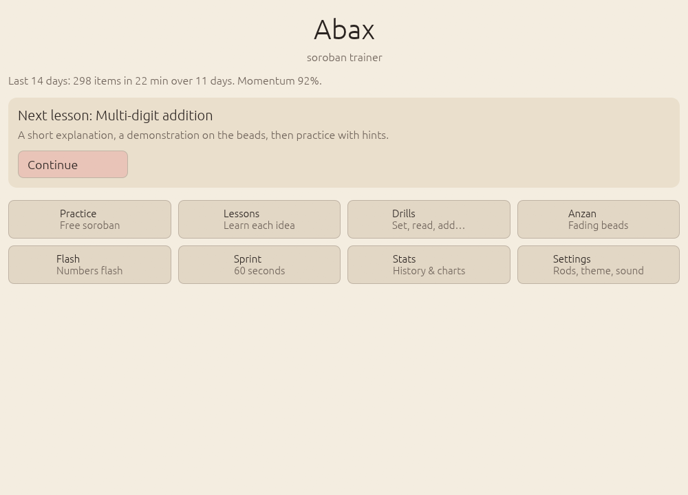
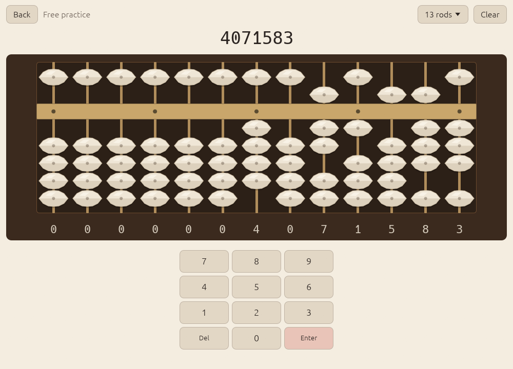
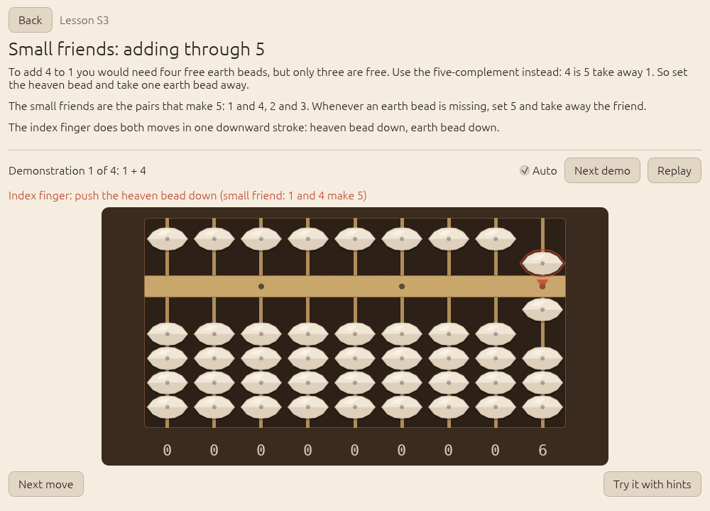
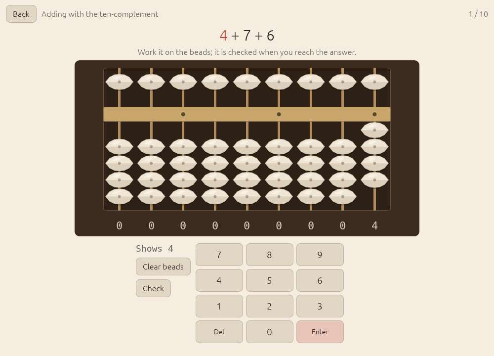
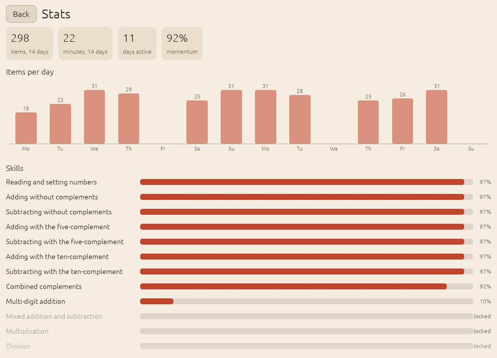
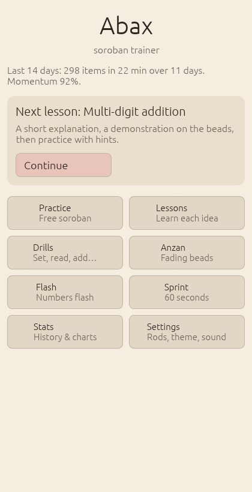
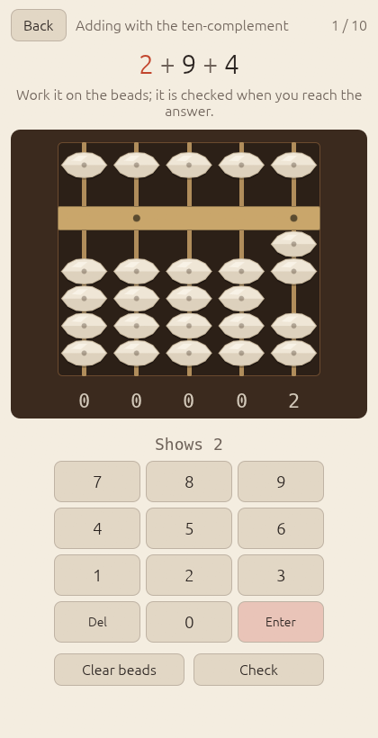

Abax is a soroban (Japanese abacus) trainer: it teaches the bead moves step by step, drills them with an adaptive scheduler, and runs as one native program on Linux, Windows, macOS and Android.

## Install

All downloads are assets of the `v0.1.0` release. The repository is private for now, so the plain links below only work for people with access; while that is the case, `gh release download v0.1.0 -R ZahakJ/abax` fetches every asset with your GitHub login.

**Linux** (x86_64; installs to `~/.local/bin`, no root):

```sh
curl -L https://github.com/ZahakJ/abax/releases/download/v0.1.0/abax-v0.1.0-linux-x86_64.tar.gz | tar xz && ./abax-v0.1.0-linux-x86_64/install.sh
```

The tarball holds `abax`, `abax.desktop`, `icon-256.png` and `install.sh`. You can also run `./abax-v0.1.0-linux-x86_64/abax` directly without installing.

**Windows** (x86_64, PowerShell):

```powershell
Invoke-WebRequest https://github.com/ZahakJ/abax/releases/download/v0.1.0/abax-v0.1.0-windows-x86_64.zip -OutFile abax.zip; Expand-Archive abax.zip -DestinationPath abax
```

Then run `abax.exe` from the `abax` folder. The binary is unsigned, so SmartScreen may ask you to confirm ("More info" > "Run anyway").

**macOS**:

```sh
# Apple silicon
curl -LO https://github.com/ZahakJ/abax/releases/download/v0.1.0/abax-v0.1.0-macos-aarch64.dmg
# Intel
curl -LO https://github.com/ZahakJ/abax/releases/download/v0.1.0/abax-v0.1.0-macos-x86_64.dmg
```

Open the dmg and drag `Abax.app` to Applications. The app is not signed, so the first launch needs right-click > Open, or run `xattr -dr com.apple.quarantine /Applications/Abax.app` once.

**Android** (7.0 or newer): on the phone, download
[abax-v0.1.0-android-arm64-v8a.apk](https://github.com/ZahakJ/abax/releases/download/v0.1.0/abax-v0.1.0-android-arm64-v8a.apk)
and open it; Android asks you to allow installing apps from that source. Almost every current phone is arm64. The
[universal APK](https://github.com/ZahakJ/abax/releases/download/v0.1.0/abax-v0.1.0-android-universal.apk)
also covers older 32-bit phones (armv7) and x86_64 emulators, at three times the size.

## Screenshots


*Home: the next lesson, 14-day momentum, and every activity one tap away.*


*Free practice: tap or drag beads, or type digits.*


*A lesson: the bead to move is ringed, with an arrow and the finger to use.*


*A drill item.*


*Stats: 14-day momentum, per-skill mastery, accuracy and speed.*

<p>


</p>

*The same screens at phone size: the soroban fills the width and the keypad sits under the thumb.*

## How it teaches

The curriculum is a small graph of 15 skills. Each skill unlocks when its prerequisites are learned:

| Id | Skill |
|----|-------|
| S0 | Read and set numbers |
| S1 | Add without complements |
| S2 | Subtract without complements |
| S3 | Add with the five-complement ("small friends", e.g. +4 = +5 −1) |
| S4 | Subtract with the five-complement |
| S5 | Add with the ten-complement ("big friends", e.g. +7 = −3, carry 1) |
| S6 | Subtract with the ten-complement |
| S7 | Combined complements (a ten-complement whose step needs a five-complement) |
| S8 | Multi-digit addition chains |
| S9 | Multi-digit mixed chains (add and subtract) |
| S10 | Multiplication (standard Japanese method) |
| S11 | Division (standard Japanese method) |
| A1 | Anzan: visualised chains with fading beads |
| A2 | Flash anzan, one digit |
| A3 | Flash anzan, two or more digits |

**Lessons.** Every skill starts with a lesson in three parts: a short explanation in plain words; a demonstration on the soroban, where the bead to move is ringed and an arrow and the finger to use (thumb or index) are shown; then guided practice, where the trainer shows the next move if you stall for four seconds.

**Drills.** Set this number; read this soroban; add/subtract chains; multiplication; division; mixed; and a 60-second sprint (as many as you can, ending on time, not on the first error).

**Anzan.** Mental calculation is trained the way soroban schools do it: first the beads fade while you keep adding (A1), then numbers flash one after another and you give the sum (A2, A3). Flash anzan climbs a speed ladder, from 3 numbers at 1.5 s each up to 15 numbers at 0.4 s each.

**When you are wrong**, Abax never just says "wrong": the correct bead moves replay on the soroban, in order.

**Finger order.** Every move list, in lessons and in replays, follows Kojima's six ordering rules: for example, in five-complement addition the heaven bead comes down before the earth beads go away, and in addition the carry onto the next rod comes after the complement on the current rod.

**Scheduler.** Each skill keeps a Bayesian Knowledge Tracing estimate of whether you know it, plus moving averages (EWMAs) of accuracy and speed, and each item has an Elo-style difficulty that is updated against you. A skill unlocks when its prerequisites reach 0.80, and is mastered only when a gate on knowledge, accuracy and speed passes. Each session is a short warm-up (a review that is due), a focus drill on your weakest unlocked skill, and a cool-down, and the stats show "momentum" over 14 days instead of a streak that resets when you miss a day.

The design is built on two research notes in this repository:
[research/soroban-mechanics-and-curriculum.md](research/soroban-mechanics-and-curriculum.md) (the instrument, finger technique, Kojima's rules, the full addition and subtraction move tables, multiplication and division, the kyu/dan grading systems, anzan) and
[research/trainer-design.md](research/trainer-design.md) (a survey of existing trainers, the learning-science principles, the scheduler's update rules and its test checklist).

## Using it

**Keyboard.** Digits set the active rod and move one rod right; Backspace clears the active rod and moves left; Left and Right arrows move the active rod in free practice; Enter (or Space) checks the answer; Escape (or Delete) clears the soroban.

**Touch and mouse.** Tap an earth bead and it moves together with the beads between it and the beam; tap the heaven bead to toggle it. You can also drag beads; on release they snap to the nearer position. The hit area of a bead is the full width of its rod, so fingers do not need precision. On phones the app has its own keypad.

**Settings.** Number of rods (9, 13, 17, 21, 23 or 27), theme (system, light, dark), sound (off by default), a left-handed layout, reduce motion, large text, the hint delay and the flash anzan defaults.

**Your data** is one JSON file, written atomically, in the platform's data directory (via the `directories` crate):

- Linux: `~/.local/share/abax/` (or `$XDG_DATA_HOME/abax/`)
- macOS: `~/Library/Application Support/abax/`
- Windows: `%APPDATA%\abax\data\`
- Android: the app's internal storage

Set `ABAX_DATA_DIR` to use another directory. Abax is fully offline: it makes no network requests.

## Performance

Measured on Linux (Wayland, Hyprland) with an NVIDIA RTX 4070 SUPER, release build, median of three runs:

| What | Result |
|------|--------|
| `App::new` to first frame | 2.9 ms |
| Whole process: launch, window, wgpu adapter, first frame, exit | 0.22 s wall, 171 MB max RSS |
| UI pass per frame, 27 rods, every bead animating (avg / p95) | 0.07 / 0.08 ms |
| CPU per frame: UI + tessellation + paint submission (avg / p95) | 0.38 / 0.53 ms |
| Frame period with vsync off (avg / p95) | 12.46 / 11.80 ms |
| Linux binary (stripped, x86_64) | 13.8 MB |
| Android APK, arm64-v8a | 9.5 MB |
| Android APK, universal (arm64, armv7, x86_64) | 28.0 MB |

The frame period sits at the display's refresh (85 Hz, 11.8 ms) even with vsync off, because the Wayland compositor paces redraws; the CPU cost of a frame is the row above it, so there is plenty of headroom. The average period is above the p95 because a few early frames (window setup) are long.

To reproduce:

```sh
cargo build --release -p abax
ABAX_BENCH=start ./target/release/abax                               # time to first frame
ABAX_BENCH=frames=400 ABAX_WINDOW=1200x800 ./target/release/abax     # 400 frames, 27 rods animating
```

Benchmark runs present without vsync (`AutoNoVsync`); normal runs use vsync. `ABAX_WINDOW=WxH` sets the window size.

## Architecture

```
crates/abax-core/     pure logic, no UI dependencies
  soroban.rs          rod and soroban model: beads <-> digits <-> numbers
  moves.rs            the bead-move engine: exact move lists for adding or
                      subtracting a digit (complements, carry, borrow)
  arith.rs            multi-digit add/sub, multiplication and division as steps
  curriculum.rs       skills, prerequisites, lessons, difficulty ladders
  generator.rs        drill item generators per skill and level
  scheduler.rs        per-skill mastery (BKT + EWMAs + Elo), session planner
  stats.rs            history, momentum, chart series
  store.rs            versioned serde model of everything saved
crates/abax/          the eframe app (desktop binary; cdylib for Android)
android/              manifest, resources, build-apk.sh (APK without Gradle)
packaging/            .desktop file, icon, install.sh, Info.plist, make-app.sh
.github/workflows/    ci.yml (checks on every push), release.yml (builds and
                      attaches the assets for a tag)
research/             the cited notes the design is built on
verify                the release gate: fmt, clippy -D warnings, tests, release build
```

There are 102 tests: 91 in `abax-core` (including the full 10x9 addition and subtraction move tables from the research notes, and worked multiplication and division examples) and 11 in the app.

Why these choices:

- **egui/eframe on wgpu.** One Rust codebase draws the same UI on every platform, the soroban is a custom-painted widget either way, and the result is a single small binary with no web runtime.
- **NativeActivity, no Gradle.** The Android app is pure native code (`hasCode="false"`), so `android/build-apk.sh` builds it with only the SDK build-tools: `aapt2` for resources, native libraries stored uncompressed, `zipalign -P 16` (16 KB pages for Android 15), `apksigner`. That is faster and more reproducible than a Gradle project. The cost is weak soft-keyboard support, which Abax does not need because it has its own keypad.
- **JSON, not SQLite.** The data is one person's history, a few thousand attempts. A versioned JSON file written atomically (temp file, fsync, rename) is simpler, needs no C code on Android, and can be read by hand.

## Building from source

You need a stable Rust toolchain.

```sh
./verify                      # formatting, clippy, tests, release build
cargo run --release -p abax   # run the desktop app
```

Android needs the SDK (build-tools and a platform), the NDK, a JDK for `apksigner`, and `cargo-ndk`:

```sh
export ANDROID_HOME=/path/to/android-sdk
export ANDROID_NDK_HOME=$ANDROID_HOME/ndk/<version>
export JAVA_HOME=/path/to/jdk
cargo install cargo-ndk
rustup target add aarch64-linux-android armv7-linux-androideabi x86_64-linux-android
android/build-apk.sh --abis arm64-v8a --out dist/abax.apk
```

Without `ABAX_KEYSTORE` the script signs with a throwaway debug key; set `ABAX_KEYSTORE`, `ABAX_KEYSTORE_PASSWORD` and `ABAX_KEY_ALIAS` for a release signature. Pass `--abis "arm64-v8a armeabi-v7a x86_64"` for a universal APK.

## Known limits

- No sound on Android in this version: the desktop audio library (cpal) needs oboe, a C++ dependency, on Android.
- The macOS and Windows binaries are unsigned, so the first launch needs the extra confirmation described above.
- No soft-keyboard text input on Android; the app's own keypad covers every input.
- The screenshots are from the Linux build.

## License

MIT, see [LICENSE](LICENSE).
