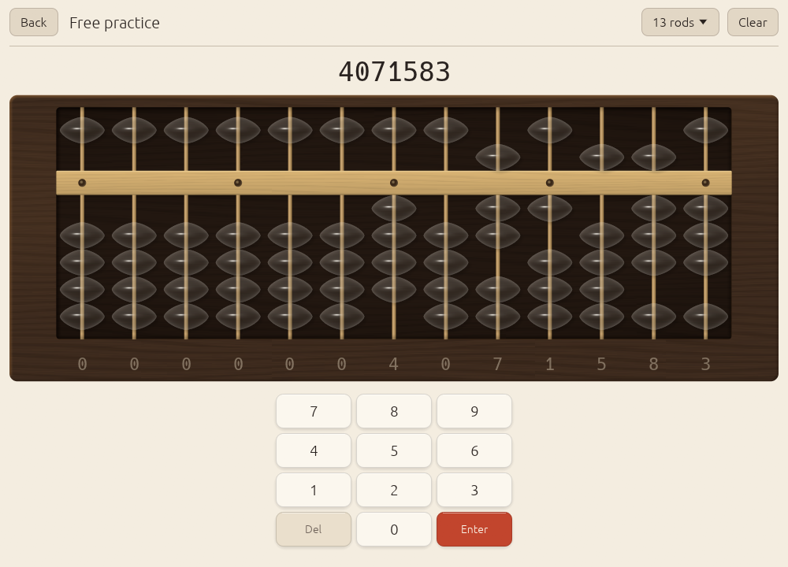

# Anzan and flash anzan

*Anzan* (暗算) is mental calculation. Soroban-trained anzan is a particular
kind: you do not recite digits, you picture a soroban and move its beads in
your mind with the same moves your fingers make. Studies of expert users
find that they hold the numbers as a visual image, rod by rod, rather than as
words. That is why Abax teaches anzan only after the bead skills: the image
is built from moves you already know by hand.

Schools build the image in stages: calculate on the real soroban, then with
it covered, then with finger movements in the air only, then with no
movement at all. Abax follows the same path in two skills.

## A1: fading beads

An anzan item is a chain, like a bead drill. The first number is set on the
soroban and you see it for a moment (0.8 s). Then the beads fade over 2.5 s:
the body of each bead turns to translucent glass first, the highlights stay
until late, and in the last quarter everything vanishes. The frame stays, so
there is still a place to put the picture. You finish the chain on the
soroban you now only imagine, and type the total.

Moving your index finger and thumb in the air as if working real beads is
fine, and Kojima recommends it.

<picture>
  <source srcset="../screenshots/glass-dark.png" media="(prefers-color-scheme: dark)">
  
</picture>

The A1 ladder: one-digit chains of 2, 3 and 5 numbers untimed, then 5 with
gentle timing, then 2-digit chains of 3 (gentle) and 5 (tight). The chains
mix addition and subtraction and may use every complement. The **Anzan**
button on the home screen starts an 8-item anzan drill at your current
step.

## A2 and A3: flash anzan

Flash anzan (フラッシュ暗算) shows numbers one at a time in the same place;
you add them as they appear and type the total after the last one. There are
no beads on screen at all. The form was developed in Japan by Yūji Miyamoto
and is now examined and competed in by the Japanese soroban federations; at
the top level, fifteen 3-digit numbers flash in under two seconds.

Each number in Abax is shown for the display time, with a short blank
between numbers (12 % of the display time, between 0.04 and 0.2 s) so that
two equal numbers in a row still read as two. A run is five rounds; after
each answer you see "Correct" or the true total.

### The ladders

The display time is per number.

**A2, one digit:**

| Step | Numbers | Display time | Whole sequence |
|------|---------|--------------|----------------|
| 1 | 3 | 1.5 s | 4.5 s |
| 2 | 5 | 1.5 s | 7.5 s |
| 3 | 5 | 1.2 s | 6.0 s |
| 4 | 5 | 1.0 s | 5.0 s |
| 5 | 8 | 0.8 s | 6.4 s |
| 6 | 10 | 0.6 s | 6.0 s |
| 7 | 10 | 0.5 s | 5.0 s |
| 8 | 15 | 0.4 s | 6.0 s |

**A3, more digits:**

| Step | Digits | Numbers | Display time | Whole sequence |
|------|--------|---------|--------------|----------------|
| 1 | 2 | 3 | 1.5 s | 4.5 s |
| 2 | 2 | 5 | 1.2 s | 6.0 s |
| 3 | 2 | 5 | 1.0 s | 5.0 s |
| 4 | 2 | 8 | 0.8 s | 6.4 s |
| 5 | 2 | 10 | 0.6 s | 6.0 s |
| 6 | 3 | 5 | 1.0 s | 5.0 s |
| 7 | 3 | 10 | 0.8 s | 8.0 s |
| 8 | 3 | 15 | 0.5 s | 7.5 s |

Every step is faster, longer or wider than the one before it. For
comparison, the Japan Flash Anzan Association's exam ladder starts at three
one-digit numbers in 5 s (1.67 s each) and its tenth dan is fifteen 3-digit
numbers in 3 s (0.2 s each). Abax's top step is a long way from that, and
the free mode below goes as fast as 0.2 s.

The same step-up and step-down rules as every other skill move you along the
ladder; a message tells you when you moved up the speed ladder or eased back
a step. When you start missing, slowing down a step and building back up is
the right thing to do: speed comes from a sharper image, not from thinking
faster.

### Free flash

The **Flash** button on the home screen opens flash anzan with your own
settings: 1 to 4 digits, 2 to 20 numbers, 0.2 to 3.0 s per number. Abax
remembers them (`flash_digits`, `flash_count`, `flash_ms` in the
[save file](save-file.md)). Answers in free flash are recorded under A2 when
the numbers have one digit and under A3 otherwise.
