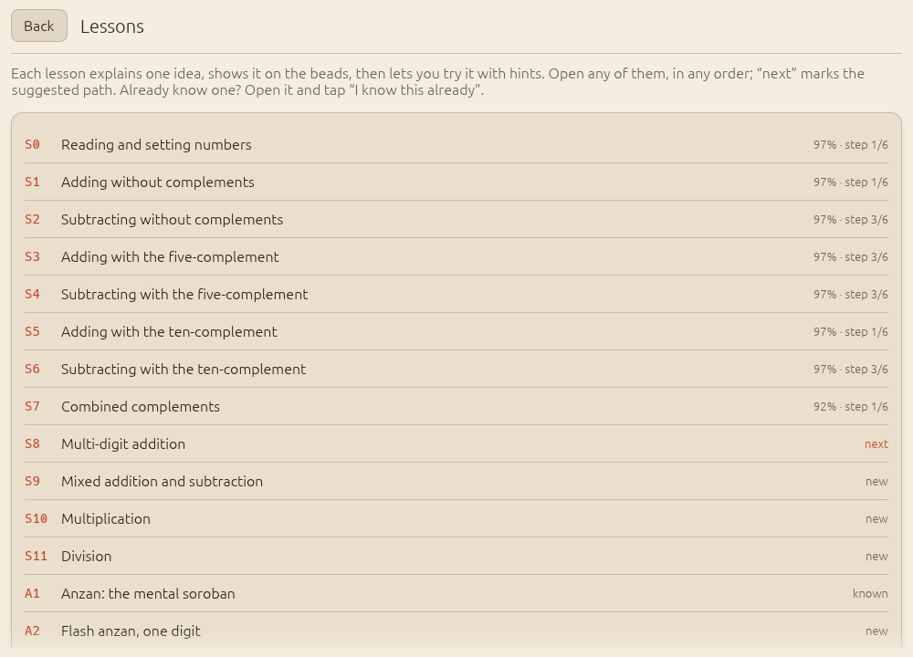

# The curriculum

Abax teaches fifteen skills. Twelve are bead skills (S0 to S11), three are
mental skills (A1 to A3). Each skill has a lesson, a drill generator that
only produces items exercising that skill's rule, and a difficulty ladder.
Everything on this page comes from `crates/abax-core/src/curriculum.rs` and
`generator.rs`.

## The graph

Nothing is locked. Every lesson opens at any time, every drill can be
picked, and you can take them in any order or skip the ones you already
know. The prerequisites below are the **suggested** path, not a gate.

A skill's prerequisites count as met when **every** one of them has a
knowledge estimate of at least 0.80 (see [the scheduler](scheduler.md)).
That threshold does three things, all of them advice:

- **The suggested next lesson.** The lesson list marks one lesson *next*,
  and Home's **Continue** opens it: the first skill, in the order of the
  table, whose prerequisites are met and which you have neither practised
  nor marked as known. It does not wait for the prerequisite to be fully
  mastered, so you meet the next idea while the previous one is still
  settling.
- **The "builds on" note.** Open a lesson whose prerequisites are not met
  yet and a small line under its title names them, for example *Builds on:
  S10 Multiplication*, each a link to that lesson. The note appears the first
  time only; it never blocks and never repeats.
- **A light review in planned sessions,** described under
  [the session planner](scheduler.md#what-today-the-session-planner).

<picture>
  <source srcset="../screenshots/lessons-dark.png" media="(prefers-color-scheme: dark)">
  
</picture>

### Skipping what you know

Every lesson has **I know this already** at the top right. It marks the
skill as known and moves you on to the suggested next lesson. Marking
does not pretend you have mastered the skill: it sets the knowledge
estimate to 0.80, the same threshold as above, not to 1. That is enough
for later skills to count it as met, and low enough that the planner keeps
checking it: a known skill is mixed into focus drills and cool-downs like
any skill you have practised, and a few answers move the estimate to where
it belongs. If you already had a higher estimate, marking never lowers it.

Changed your mind? A lesson you marked shows **Reset this skill** in the same
place, and **Settings → Data → Reset one skill** does the same for any
skill. A reset puts that one skill back to new, as if never met; your
history in Stats is kept. When the skill has real practice behind it, the
reset asks for a second tap.

| Id | Skill | Prerequisites |
|----|-------|---------------|
| S0 | Reading and setting numbers | none |
| S1 | Adding without complements | S0 |
| S2 | Subtracting without complements | S0 |
| S3 | Adding with the five-complement | S1 |
| S4 | Subtracting with the five-complement | S2, S3 |
| S5 | Adding with the ten-complement | S3 |
| S6 | Subtracting with the ten-complement | S4, S5 |
| S7 | Combined complements | S5, S6 |
| S8 | Multi-digit addition | S7 |
| S9 | Mixed addition and subtraction | S8 |
| S10 | Multiplication | S8 |
| S11 | Division | S10 |
| A1 | Anzan: the mental soroban | S7 |
| A2 | Flash anzan, one digit | A1, S9 |
| A3 | Flash anzan, more digits | A2 |

Moves below use the notation from [Finger rules](fingers.md): `+3` is three
earth beads up (thumb), `−2` two earth beads down (index), `+5` and `−5` the
heaven bead down and up (index), `+1 left` a carry onto the next rod.

## Ladders

Each skill climbs a ladder of steps, raising one thing at a time: first the
number of operands, then digits, then time pressure. "Gentle" timing allows
2.0 times your typical time per operand, "tight" 1.3 times, never less than
1.2 s per operand.

| Ladder | Used by | Steps (digits × operands, timing) |
|--------|---------|-----------------------------------|
| Setting | S0 | 1, 2, 3 digits untimed; 3 gentle; 4 gentle; 5 tight |
| Simple | S1, S2 | 1×2, 1×3, 1×5 untimed; 1×5 gentle; 1×8 gentle; 1×8 tight |
| Complement | S3 to S7 | same steps as Simple |
| Multi-digit | S8, S9 | 2×2, 2×3, 2×5, 3×3, 3×5 untimed; 2×5 gentle; 3×5 gentle; 3×10 tight |
| Multiply | S10 | 1×1, 2×1, 3×1, 2×2 untimed; 2×2 gentle; 3×2 gentle; 3×2 tight |
| Divide | S11 | 2÷1, 3÷1, 4÷1, 3÷2 untimed; 4÷2 gentle; 4÷2 tight |
| Anzan | A1 | 1×2, 1×3, 1×5 untimed; 1×5 gentle; 2×3 gentle; 2×5 tight |
| Flash, one digit | A2 | see [Anzan and flash anzan](anzan.md) |
| Flash, more digits | A3 | see [Anzan and flash anzan](anzan.md) |

For multiplication "3×2" means a 3-digit multiplicand times a 2-digit
multiplier; for division "4÷2" a 4-digit dividend and a 2-digit divisor.

## S0: Reading and setting numbers

**Teaches** the rods, the beam, the values of the beads and the unit dots.
**Drills** "Set this number" and "Read this soroban", half each, with 1 to 5
digits. Set 7 is `+5, +2` (one pinch); set 406 is `+4` on the hundreds, then
`+5, +1` on the units.

## S1: Adding without complements

**Rule:** when the beads you need are free, push them to the beam. The thumb
pushes earth beads up, the index finger brings the heaven bead down; for 6
to 9 both move together. **Drills** chains of one-digit additions in which
no complement is ever needed. Examples from the lesson: 2 + 2 is `+2`;
3 + 5 is `+5`; 1 + 6 is `+5, +1` in one pinch; 12 + 36 is `+3` on the tens,
then `+5, +1` on the units.

## S2: Subtracting without complements

**Rule:** move beads away from the beam with the index finger; for 6 to 9,
earth beads first, then the heaven bead. **Drills** one-digit subtraction
chains with no complement. Examples: 4 − 3 is `−3`; 8 − 5 is `−5`; 9 − 7 is
`−2, −5`; 87 − 52 is `−5` on the tens, `−2` on the units.

## S3: Adding with the five-complement

**Rule:** when the earth beads you need are not free, add 5 and take away
the "small friend" (the number that makes 5 with it: 1 and 4, 2 and 3).
Heaven bead first, then the earth beads, both with the index finger.
**Drills** addition chains that must use the five-complement at least once
and never need a carry. Examples: 1 + 4 is `+5, −1`; 3 + 3 is `+5, −2`;
4 + 2 is `+5, −3`; 23 + 34 is `+5, −2` on the tens and `+5, −1` on the
units.

<svg class="abax-diagram" viewBox="0 0 470 266" role="img" aria-labelledby="t-five d-five" xmlns="http://www.w3.org/2000/svg"><title id="t-five">Adding 3 to 3 with the five-complement</title><desc id="d-five">Three panels of one rod. It shows 3. The index finger brings the heaven bead down, making 8. Then the index finger pushes two earth beads down, leaving 6. Adding 3 is done as adding 5 and taking away 2.</desc><text class="sb-label sb-step" x="65.0" y="20" text-anchor="middle">3</text><rect class="sb-frame" x="30" y="34" width="70" height="182" rx="8"/><rect class="sb-well" x="38" y="42" width="54" height="166" rx="3"/><line class="sb-rod" x1="65" y1="42" x2="65" y2="208"/><rect class="sb-beam" x="38" y="80" width="54" height="14"/><path class="sb-bead" d="M46.0 55.0 Q65.0 33.0 84.0 55.0 Q65.0 77.0 46.0 55.0Z"/><path class="sb-bead" d="M46.0 106.0 Q65.0 84.0 84.0 106.0 Q65.0 128.0 46.0 106.0Z"/><path class="sb-bead" d="M46.0 130.0 Q65.0 108.0 84.0 130.0 Q65.0 152.0 46.0 130.0Z"/><path class="sb-bead" d="M46.0 154.0 Q65.0 132.0 84.0 154.0 Q65.0 176.0 46.0 154.0Z"/><path class="sb-bead" d="M46.0 195.0 Q65.0 173.0 84.0 195.0 Q65.0 217.0 46.0 195.0Z"/><text class="sb-num" x="65" y="234" text-anchor="middle">3</text><text class="sb-label sb-step" x="235.0" y="20" text-anchor="middle">+5</text><rect class="sb-frame" x="200" y="34" width="70" height="182" rx="8"/><rect class="sb-well" x="208" y="42" width="54" height="166" rx="3"/><line class="sb-rod" x1="235" y1="42" x2="235" y2="208"/><rect class="sb-beam" x="208" y="80" width="54" height="14"/><path class="sb-ghost" d="M216.0 55.0 Q235.0 33.0 254.0 55.0 Q235.0 77.0 216.0 55.0Z"/><path class="sb-bead sb-move" d="M216.0 68.0 Q235.0 46.0 254.0 68.0 Q235.0 90.0 216.0 68.0Z"/><path class="sb-bead" d="M216.0 106.0 Q235.0 84.0 254.0 106.0 Q235.0 128.0 216.0 106.0Z"/><path class="sb-bead" d="M216.0 130.0 Q235.0 108.0 254.0 130.0 Q235.0 152.0 216.0 130.0Z"/><path class="sb-bead" d="M216.0 154.0 Q235.0 132.0 254.0 154.0 Q235.0 176.0 216.0 154.0Z"/><path class="sb-bead" d="M216.0 195.0 Q235.0 173.0 254.0 195.0 Q235.0 217.0 216.0 195.0Z"/><text class="sb-num" x="235" y="234" text-anchor="middle">8</text><line class="sb-arrow" x1="263" y1="55" x2="263" y2="62"/><path class="sb-arrowhead" d="M258 60 L263 68 L268 60Z"/><text class="sb-label sb-step" x="405.0" y="20" text-anchor="middle">−2</text><rect class="sb-frame" x="370" y="34" width="70" height="182" rx="8"/><rect class="sb-well" x="378" y="42" width="54" height="166" rx="3"/><line class="sb-rod" x1="405" y1="42" x2="405" y2="208"/><rect class="sb-beam" x="378" y="80" width="54" height="14"/><path class="sb-ghost" d="M386.0 130.0 Q405.0 108.0 424.0 130.0 Q405.0 152.0 386.0 130.0Z"/><path class="sb-ghost" d="M386.0 154.0 Q405.0 132.0 424.0 154.0 Q405.0 176.0 386.0 154.0Z"/><path class="sb-bead" d="M386.0 68.0 Q405.0 46.0 424.0 68.0 Q405.0 90.0 386.0 68.0Z"/><path class="sb-bead" d="M386.0 106.0 Q405.0 84.0 424.0 106.0 Q405.0 128.0 386.0 106.0Z"/><path class="sb-bead sb-move" d="M386.0 147.0 Q405.0 125.0 424.0 147.0 Q405.0 169.0 386.0 147.0Z"/><path class="sb-bead sb-move" d="M386.0 171.0 Q405.0 149.0 424.0 171.0 Q405.0 193.0 386.0 171.0Z"/><path class="sb-bead" d="M386.0 195.0 Q405.0 173.0 424.0 195.0 Q405.0 217.0 386.0 195.0Z"/><text class="sb-num" x="405" y="234" text-anchor="middle">6</text><line class="sb-arrow" x1="433" y1="130" x2="433" y2="165"/><path class="sb-arrowhead" d="M428 163 L433 171 L438 163Z"/><text class="sb-label sb-soft sb-small" x="65.0" y="256" text-anchor="middle">start: 3</text><text class="sb-label sb-soft sb-small" x="235.0" y="256" text-anchor="middle">index: heaven bead down</text><text class="sb-label sb-soft sb-small" x="405.0" y="256" text-anchor="middle">index: 2 earth down</text></svg>

## S4: Subtracting with the five-complement

**Rule:** when the earth beads to take are not at the beam, take 5 away and
give back the small friend: earth beads up with the thumb first, then the
heaven bead up with the index finger. **Drills** subtraction chains that use
it. Examples: 6 − 4 is `+1, −5`; 5 − 2 is `+3, −5`; 7 − 3 is `+2, −5`;
65 − 42 is `+1, −5` on the tens and `+3, −5` on the units.

## S5: Adding with the ten-complement

**Rule:** when the sum would pass 9, take away the "big friend" (the number
that makes 10: 1 and 9, 2 and 8, 3 and 7, 4 and 6, 5 and 5) on this rod,
then carry 1 onto the rod to the left. **Drills** addition chains that need
a carry at least once (five-complements may appear too). Examples:
4 + 8 is `−2, +1 left`; 9 + 1 is `−4, −5, +1 left` (taking away 9, the
friend of 1); 5 + 5 is `−5, +1 left`; 38 + 27 is `+5, −3` on the tens
(a five-complement), then `−3` on the units and `+1 left`, giving 65.

<svg class="abax-diagram" viewBox="0 0 516 266" role="img" aria-labelledby="t-ten d-ten" xmlns="http://www.w3.org/2000/svg"><title id="t-ten">Adding 8 to 4 with the ten-complement</title><desc id="d-ten">Three panels of two rods. The units rod shows 4. The index finger takes away 2 earth beads, the friend of 8, leaving 2. Then the thumb pushes one earth bead up on the tens rod. The result is 12.</desc><text class="sb-label sb-step" x="88.0" y="20" text-anchor="middle">4</text><rect class="sb-frame" x="30" y="34" width="116" height="182" rx="8"/><rect class="sb-well" x="38" y="42" width="100" height="166" rx="3"/><line class="sb-rod" x1="65" y1="42" x2="65" y2="208"/><line class="sb-rod" x1="111" y1="42" x2="111" y2="208"/><rect class="sb-beam" x="38" y="80" width="100" height="14"/><path class="sb-bead" d="M46.0 55.0 Q65.0 33.0 84.0 55.0 Q65.0 77.0 46.0 55.0Z"/><path class="sb-bead" d="M46.0 123.0 Q65.0 101.0 84.0 123.0 Q65.0 145.0 46.0 123.0Z"/><path class="sb-bead" d="M46.0 147.0 Q65.0 125.0 84.0 147.0 Q65.0 169.0 46.0 147.0Z"/><path class="sb-bead" d="M46.0 171.0 Q65.0 149.0 84.0 171.0 Q65.0 193.0 46.0 171.0Z"/><path class="sb-bead" d="M46.0 195.0 Q65.0 173.0 84.0 195.0 Q65.0 217.0 46.0 195.0Z"/><path class="sb-bead" d="M92.0 55.0 Q111.0 33.0 130.0 55.0 Q111.0 77.0 92.0 55.0Z"/><path class="sb-bead" d="M92.0 106.0 Q111.0 84.0 130.0 106.0 Q111.0 128.0 92.0 106.0Z"/><path class="sb-bead" d="M92.0 130.0 Q111.0 108.0 130.0 130.0 Q111.0 152.0 92.0 130.0Z"/><path class="sb-bead" d="M92.0 154.0 Q111.0 132.0 130.0 154.0 Q111.0 176.0 92.0 154.0Z"/><path class="sb-bead" d="M92.0 178.0 Q111.0 156.0 130.0 178.0 Q111.0 200.0 92.0 178.0Z"/><text class="sb-num" x="65" y="234" text-anchor="middle">0</text><text class="sb-num" x="111" y="234" text-anchor="middle">4</text><text class="sb-label sb-step" x="258.0" y="20" text-anchor="middle">−2</text><rect class="sb-frame" x="200" y="34" width="116" height="182" rx="8"/><rect class="sb-well" x="208" y="42" width="100" height="166" rx="3"/><line class="sb-rod" x1="235" y1="42" x2="235" y2="208"/><line class="sb-rod" x1="281" y1="42" x2="281" y2="208"/><rect class="sb-beam" x="208" y="80" width="100" height="14"/><path class="sb-bead" d="M216.0 55.0 Q235.0 33.0 254.0 55.0 Q235.0 77.0 216.0 55.0Z"/><path class="sb-bead" d="M216.0 123.0 Q235.0 101.0 254.0 123.0 Q235.0 145.0 216.0 123.0Z"/><path class="sb-bead" d="M216.0 147.0 Q235.0 125.0 254.0 147.0 Q235.0 169.0 216.0 147.0Z"/><path class="sb-bead" d="M216.0 171.0 Q235.0 149.0 254.0 171.0 Q235.0 193.0 216.0 171.0Z"/><path class="sb-bead" d="M216.0 195.0 Q235.0 173.0 254.0 195.0 Q235.0 217.0 216.0 195.0Z"/><path class="sb-ghost" d="M262.0 154.0 Q281.0 132.0 300.0 154.0 Q281.0 176.0 262.0 154.0Z"/><path class="sb-ghost" d="M262.0 178.0 Q281.0 156.0 300.0 178.0 Q281.0 200.0 262.0 178.0Z"/><path class="sb-bead" d="M262.0 55.0 Q281.0 33.0 300.0 55.0 Q281.0 77.0 262.0 55.0Z"/><path class="sb-bead" d="M262.0 106.0 Q281.0 84.0 300.0 106.0 Q281.0 128.0 262.0 106.0Z"/><path class="sb-bead" d="M262.0 130.0 Q281.0 108.0 300.0 130.0 Q281.0 152.0 262.0 130.0Z"/><path class="sb-bead sb-move" d="M262.0 171.0 Q281.0 149.0 300.0 171.0 Q281.0 193.0 262.0 171.0Z"/><path class="sb-bead sb-move" d="M262.0 195.0 Q281.0 173.0 300.0 195.0 Q281.0 217.0 262.0 195.0Z"/><text class="sb-num" x="235" y="234" text-anchor="middle">0</text><text class="sb-num" x="281" y="234" text-anchor="middle">2</text><line class="sb-arrow" x1="309" y1="154" x2="309" y2="189"/><path class="sb-arrowhead" d="M304 187 L309 195 L314 187Z"/><text class="sb-label sb-step" x="428.0" y="20" text-anchor="middle">+1 on the left</text><rect class="sb-frame" x="370" y="34" width="116" height="182" rx="8"/><rect class="sb-well" x="378" y="42" width="100" height="166" rx="3"/><line class="sb-rod" x1="405" y1="42" x2="405" y2="208"/><line class="sb-rod" x1="451" y1="42" x2="451" y2="208"/><rect class="sb-beam" x="378" y="80" width="100" height="14"/><path class="sb-ghost" d="M386.0 123.0 Q405.0 101.0 424.0 123.0 Q405.0 145.0 386.0 123.0Z"/><path class="sb-bead" d="M386.0 55.0 Q405.0 33.0 424.0 55.0 Q405.0 77.0 386.0 55.0Z"/><path class="sb-bead sb-move" d="M386.0 106.0 Q405.0 84.0 424.0 106.0 Q405.0 128.0 386.0 106.0Z"/><path class="sb-bead" d="M386.0 147.0 Q405.0 125.0 424.0 147.0 Q405.0 169.0 386.0 147.0Z"/><path class="sb-bead" d="M386.0 171.0 Q405.0 149.0 424.0 171.0 Q405.0 193.0 386.0 171.0Z"/><path class="sb-bead" d="M386.0 195.0 Q405.0 173.0 424.0 195.0 Q405.0 217.0 386.0 195.0Z"/><path class="sb-bead" d="M432.0 55.0 Q451.0 33.0 470.0 55.0 Q451.0 77.0 432.0 55.0Z"/><path class="sb-bead" d="M432.0 106.0 Q451.0 84.0 470.0 106.0 Q451.0 128.0 432.0 106.0Z"/><path class="sb-bead" d="M432.0 130.0 Q451.0 108.0 470.0 130.0 Q451.0 152.0 432.0 130.0Z"/><path class="sb-bead" d="M432.0 171.0 Q451.0 149.0 470.0 171.0 Q451.0 193.0 432.0 171.0Z"/><path class="sb-bead" d="M432.0 195.0 Q451.0 173.0 470.0 195.0 Q451.0 217.0 432.0 195.0Z"/><text class="sb-num" x="405" y="234" text-anchor="middle">1</text><text class="sb-num" x="451" y="234" text-anchor="middle">2</text><line class="sb-arrow" x1="433" y1="123" x2="433" y2="112"/><path class="sb-arrowhead" d="M428 114 L433 106 L438 114Z"/><text class="sb-label sb-soft sb-small" x="88.0" y="256" text-anchor="middle">start: 4</text><text class="sb-label sb-soft sb-small" x="258.0" y="256" text-anchor="middle">index: take the friend 2</text><text class="sb-label sb-soft sb-small" x="428.0" y="256" text-anchor="middle">thumb: carry 1 left</text></svg>

## S6: Subtracting with the ten-complement

**Rule:** when the rod does not hold enough, borrow 1 from the rod on the
left first, then add the big friend on this rod. **Drills** subtraction
chains that need a borrow. Examples: 11 − 7 is `−1 left, +3`;
10 − 1 is `−1 left, +5, +4`; 15 − 8 is `−1 left, +2`; 62 − 38 is `+2, −5`
on the tens, then `−1 left, +2` on the units, giving 24.

## S7: Combined complements

**Rule:** the ten-complement's own move on the rod sometimes cannot be made
directly and needs a five-complement inside it. 7 + 6: taking away 4 (the
friend of 6) from 7 is impossible with two earth beads up, so take 4 through
5: `+1, −5`, then `+1 left`, giving 13. In subtraction, 12 − 7: borrow
(`−1 left`), then add 3 to the 2 on the units rod, which needs the small
friend: `+5, −2`, giving 5. **Drills** mixed chains that must contain a
combined move. Other lesson examples: 6 + 8 is `+3, −5, +1 left`;
13 − 6 is `−1 left, +5, −1`.

Exactly these one-rod additions are combined: 5 + 6 to 5 + 9, 6 + 6 to
6 + 8, 7 + 6, 7 + 7 and 8 + 6. (8 + 7 is not: 8 has three earth beads up, so
`−3, +1 left` works directly.)

## S8: Multi-digit addition

**Rule:** nothing new. Add each digit on its own rod, from the left; carries
travel left, so they never land on a rod you still have to visit.
**Drills** chains of 2- and 3-digit numbers, 2 to 10 operands, any
complement allowed. Example: 478 + 365. Hundreds: 4 + 3 is `+5, −2`. Tens:
7 + 6 is the combined move `+1, −5`, then `+1` on the hundreds. Units:
8 + 5 is `−5`, then `+1` on the tens. Result 843. And 1999 + 1, where one
carry ripples across three rods: `−4, −5` on the units, tens and hundreds in
turn, then `+1` on the thousands.

## S9: Mixed addition and subtraction

**Rule:** every operation lands on the running total, so plus and minus mix
freely. Before a subtraction, look left to see where a borrow will come
from. **Drills** mixed chains of multi-digit numbers. Example:
843 − 599. Hundreds: `−5`. Tens: 4 − 9 borrows 1 from the hundreds and adds
1 to the tens, which on a rod showing 4 is `+5, −4`. Units: 3 − 9 borrows
from the tens (5 − 1 is `+4, −5`), then adds 1 on the units. Result 244.

## S10: Multiplication

**Method:** Kojima's standard method. Set the multiplier on the left and the
multiplicand to its right with two empty rods between. Multiply the
*rightmost* digit of the multiplicand by each multiplier digit from left to
right. Each two-digit partial product goes with its tens on the first rod to
the right of the multiplicand digit being used, and each next one shifts a
rod further right. Clear the multiplicand digit, move to the next one to the
left. The product's units end up (digits of the multiplier + 1) rods to the
right of the multiplicand's units. **Drills** products from 1 × 1 digits up
to 3 × 2 digits; you type the answer and can step through the worked
procedure.

Abax's own walk-through of 23 × 12:

1. Set the multiplier 12 on the left.
2. Set the multiplicand 23 with its units on the unit rod, two empty rods
   after the multiplier.
3. 3 × 1 = 03: add it with its tens on the first rod right of the 3.
4. 3 × 2 = 06: add it one rod further right.
5. Clear the 3.
6. 2 × 1 = 02, tens on the first rod right of the 2; 2 × 2 = 04 one rod
   further right.
7. Clear the 2 and read 276, three rods right of where the multiplicand's
   units were.

## S11: Division

**Method:** the standard method (商除法, *shōjohō*). Set the dividend with its
units on a unit rod and the divisor on the left, four empty rods away.
Compare the divisor with the leading digits of the dividend and guess a
quotient digit; it goes two rods left of the dividend's leading digit when
the divisor goes into that one digit, one rod left when two digits are
needed. Subtract quotient × divisor digit by digit. If a partial product
cannot be subtracted, the guess was too large: lower it by one and add back
what was already taken. If what remains is still at least the divisor, the
guess was too small: raise it and subtract once more. **Drills** exact
divisions from 2-digit ÷ 1-digit up to 4-digit ÷ 2-digit.

Abax's walk-through of 391 ÷ 17 revises twice, the way a learner would:
try 3 (from 3 ÷ 1), find 3 × 7 cannot be taken, revise to 2 and take 2 × 7;
then try 5, revise to 4, then to 3, and take 3 × 7. The quotient 23 is read
three rods left of the dividend's units.

## A1: Anzan, the mental soroban

**Teaches** calculating on a soroban you picture. The start of each item is
set on the beads, the beads fade to glass and vanish, and you add the rest
in your head and type the total. **Drills** one-digit chains of mixed addition and
subtraction with any complement, then 2-digit chains. Details in
[Anzan and flash anzan](anzan.md).

## A2 and A3: Flash anzan

**Teaches** adding numbers that flash one after another, without beads at
all. A2 uses one-digit numbers, A3 two and three digits. The ladders are in
[Anzan and flash anzan](anzan.md).
