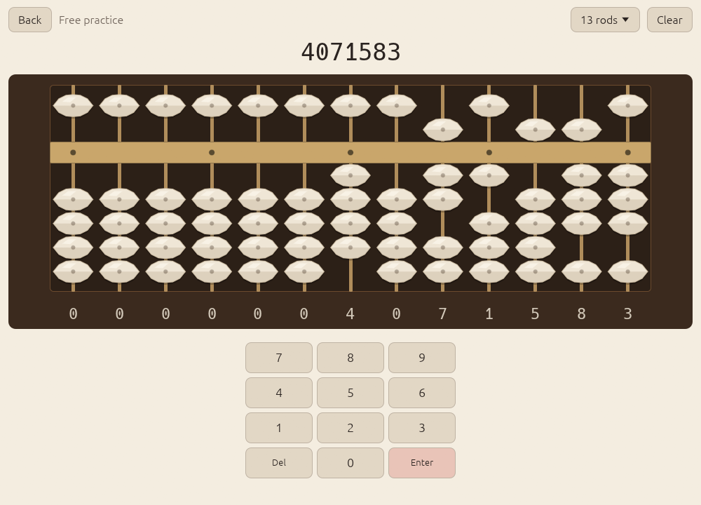

# Rendering

## What is drawn, and why on the GPU

Everything in Abax except the soroban itself is ordinary [egui](https://github.com/emilk/egui):
text, buttons, the keypad, charts, hint arrows and the digits under the rods.
The soroban is different. It is the one thing you look at all the time, and
it should read as a solid instrument on a desk.

A bead reads as solid when its shading changes smoothly over its surface:
lit on one side, darker on the other, a small bright highlight, darker at
the edge, darker still where it touches its neighbour, with a soft shadow
on the board. Version 0.1 drew each bead as a stack of flat egui polygons
with vertex colours. That gives bands, not surfaces, and costs about a dozen
shapes per bead, or 135 beads × 12 at 27 rods.

<figure>

<figcaption>Version 0.1: polygons and vertex colours.</figcaption>
</figure>

<figure>
<picture>
  <source srcset="../screenshots/practice-dark.png" media="(prefers-color-scheme: dark)">
  
</picture>
<figcaption>Version 0.2: one instanced draw, shaded per pixel.</figcaption>
</figure>

Since 0.2.0 the soroban is one `egui_wgpu` paint callback: **one pipeline,
one instanced draw, shaded per pixel in WGSL**
(`crates/abax/src/render/mod.rs` and `soroban.wgsl`). The reasons:

- **Per-pixel lighting** is what makes the solid look solid; a fragment
  shader computes it directly.
- **Wood grain, lacquer sheen, bevels and a vignette** are a few lines of
  procedural noise and distance math. As textures they would need an atlas
  per theme and per screen density.
- **It is cheap.** One draw call per soroban with a few hundred instances,
  and the per-pixel work is short distance-field math.
- **No new dependency.** eframe already renders through wgpu on every
  target, desktop and Android, and re-exports it. WGSL is translated by
  naga to Vulkan, Metal, DirectX 12 and OpenGL ES, so one shader covers all
  four platforms.

## How it works

Every part of the instrument is one instance of a unit quad, drawn in this
order: the board, the recessed well, the glow behind the active rod, the
rods, the beam, the unit dots, an underline, hint halos, bead shadows, and
the beads. Each instance is 96 bytes: a rectangle, a kind, four parameters
and three colours. `SorobanView::build_instances` fills a reused `Vec` on the
CPU each frame; the callback's `prepare` copies it into the instance buffer
and `paint` issues the single draw. Each soroban on screen (the home screen
has a small live one) owns its own instance and uniform buffers.

The fragment shader picks a shading function by kind:

- **Beads** are solids of revolution around the rod. The silhouette is a
  superellipse lens, pointed at the sides like a real biconical soroban
  bead, with the equator ridge slightly softened. From the profile the
  shader derives a surface normal, then lights it with a key light from the
  upper left: diffuse, a specular lobe, rim darkening at grazing angles,
  ambient occlusion where a bead touches its neighbour or the beam, and the
  dark bore where the rod enters. A short brightening marks a bead you just
  moved. For anzan the bead turns to glass: the body goes translucent first,
  the highlights last.
- **Shadows** are the lens silhouette, blurred, under each bead.
- **Rods** are thin cylinders: bamboo, brass or steel.
- **The beam** is bevelled lacquered wood with faint grain, or metal, with
  small inset pins for the unit dots.
- **The board** is grained wood with a lit and a shaded bevel, rounded
  corners and a soft diagonal sheen; the **well** inside it is darker, with
  an inner shadow cast by the frame and a vignette.

The shader works in linear light and encodes at the end for whichever
target format egui uses, with premultiplied alpha, so its output blends
exactly like egui's own meshes.

### Finishes

| Finish | Frame | Rods and beam | Beads |
|--------|-------|---------------|-------|
| Walnut (default) | lacquered walnut, warm grain | bamboo | bone |
| Ebony | near-black ebony, fine grain | brass | bone |
| Maple | pale maple, fine grain | steel | slate |

Each is tuned separately for the light and the dark theme. Vermilion stays
the single accent in all of them.

### Fallback

If eframe starts without a wgpu render state, Abax logs a warning and draws
the soroban with the previous egui painter, so the board is never empty.

## Performance

Measured on Linux (Wayland, Hyprland) with an NVIDIA RTX 4070 SUPER on an
85 Hz display, release build, 1200 × 800 window, 27 rods with every bead
animating every frame:

```sh
cargo build --release -p abax
ABAX_BENCH=frames=400 ABAX_WINDOW=1200x800 ./target/release/abax
```

| Per frame (average / 95th percentile) | v0.1.0, egui polygons | v0.2.0, wgpu callback |
|---------------------------------------|-----------------------|-----------------------|
| UI pass | 0.07 / 0.09 ms | 0.04 / 0.06 ms |
| CPU: UI, tessellation and paint submission | 0.38 / 0.54 ms | 0.18 / 0.23 ms |
| Frame period | 12.5 / 11.8 ms | 12.5 / 11.8 ms |

The CPU cost halved because the soroban no longer goes through egui's
tessellator: it is a few hundred 96-byte instances instead of thousands of
polygon vertices.

How to read this:

- **The benchmark measures CPU time only**, not GPU time. The shading work
  moved to the GPU, and that cost is not in these numbers. On this machine
  it is too small to affect the frame period.
- **The frame period is the display's**, in both versions. Benchmark runs
  present without vsync (`AutoNoVsync`), but the Wayland compositor still
  paces redraws at the 85 Hz refresh (11.8 ms). The average is above the
  95th percentile because the first few frames, while the window is being
  set up, are long.
- **Start-up.** `ABAX_BENCH=start` prints the time from the top of
  `App::new` to the first frame. In v0.2.0 that is 21 to 28 ms, and it
  includes loading the profile, opening audio and creating the pipeline
  (2.5 ms of it). The v0.1.0 figure of 2.7 ms excluded those steps, so the
  two numbers are not comparable.
- The stripped Linux x86_64 binary is 13.9 MB.

`ABAX_BENCH=frames=N` prints one line after N frames:

```text
ABAX_BENCH frames=390 rods=27 ui-pass avg/p95=… ms cpu-frame avg/p95=… ms frame period avg/p95=… ms
```

The first 10 frames are left out of the statistics.

## Screenshot and capture modes

All captures on the website and in this manual come from the app itself,
driven by environment variables (desktop only).

| Variable | Effect |
|----------|--------|
| `ABAX_WINDOW=WxH` | Window size in points, for example `1000x720` or `420x820`. |
| `ABAX_SHOT=<screen>:<file.png>` | Open `<screen>`, wait 40 frames, save a PNG, exit. The window is fixed-size and undecorated, so tiling window managers float it. |
| `ABAX_SHOT=<screen>:<dir>/` | Sequence mode (the path ends in `/`): record 48 consecutive frames as `frame-000.png` … `frame-047.png` while the practice soroban runs a scripted set of moves. |
| `ABAX_DEMO_DATA=1` | Fill the history and scheduler with a plausible two weeks of practice, so the stats and home screens have something to show. |
| `ABAX_DATA_DIR=<dir>` | Use the profile in `<dir>`; this is how a capture picks its theme and finish. |
| `ABAX_BENCH=start` or `frames=N` | The benchmarks above. |

Screens for `ABAX_SHOT`: `home`, `practice` (4071583 on the beads), `glass`
(the same, part-way through the anzan fade), `lesson` (lesson S3),
`lesson-gap` (lesson S11, opened ahead of its prerequisite), `drill`
(an S5 drill), `stats`, `lessons`, `flash` (the flash anzan setup),
`flash-run` (a number mid-flash), `settings`. Anything else opens home.

`ABAX_DEMO_DATA` changes the profile it runs with, so always pair it with a
throwaway `ABAX_DATA_DIR`. A capture in the dark theme with the ebony finish:

```sh
mkdir -p /tmp/abax-shot
echo '{"version":1,"settings":{"theme":"Dark","finish":"Ebony","rod_count":13}}' \
  > /tmp/abax-shot/profile.json
ABAX_DATA_DIR=/tmp/abax-shot ABAX_DEMO_DATA=1 ABAX_WINDOW=1000x720 \
  ABAX_SHOT=practice:practice-ebony-dark.png ./target/release/abax
```

The landing page's hero loop is a sequence: the soroban moves from empty to
4071583, then 2958, then 7310246. The 48 frames, cropped to the soroban, play
at 20 frames per second. The hero loop on the landing page was made with:

```sh
mkdir -p shot/profile shot/frames
ABAX_DATA_DIR=shot/profile ABAX_WINDOW=1000x720 \
  ABAX_SHOT=practice:$PWD/shot/frames/ ./target/release/abax
# crop to the soroban, then encode the two formats the landing page uses
ffmpeg -framerate 20 -i shot/frames/frame-%03d.png -vf crop=976:370:12:118 \
  -pix_fmt yuv420p -c:v libx264 -crf 20 -movflags +faststart hero.mp4
ffmpeg -framerate 20 -i shot/frames/frame-%03d.png -vf crop=976:370:12:118 \
  -pix_fmt yuv420p -c:v libvpx-vp9 -b:v 0 -crf 30 -an hero.webm
```
