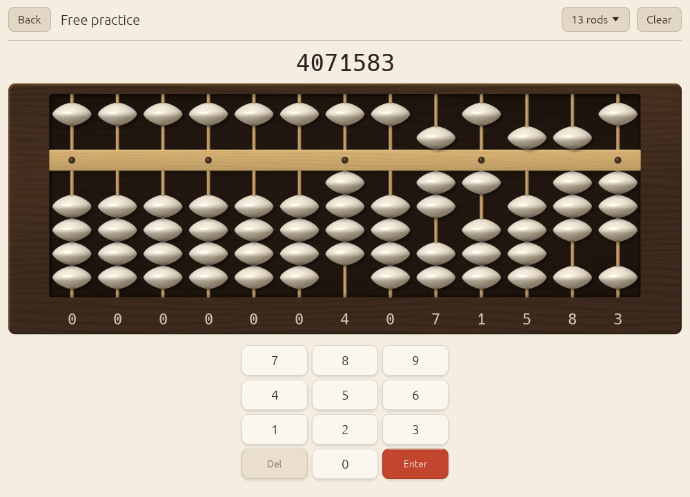

# Rendering

Everything except the soroban is ordinary [egui](https://github.com/emilk/egui):
text, buttons, the keypad, charts, hint arrows and the digits under the rods.
The soroban is one `egui_wgpu` paint callback: **one pipeline, one instanced
draw, shaded per pixel in WGSL** (`crates/abax/src/render/mod.rs` and
`soroban.wgsl`). eframe already renders through wgpu on every target; naga
translates the WGSL to Vulkan, Metal, DirectX 12 and OpenGL ES.

<picture>
  <source srcset="../screenshots/practice-dark.png" media="(prefers-color-scheme: dark)">
  
</picture>

## How it works

Every part of the instrument is one instance of a unit quad, drawn in this
order: the board, the recessed well, the glow behind the active rod, the
rods, the beam, the unit dots, an underline, hint halos, bead shadows, and
the beads. Each instance is 96 bytes: a rectangle, a kind, four parameters
and three colours. `SorobanView::build_instances` fills a reused `Vec` on the
CPU each frame; the callback's `prepare` copies it into the instance buffer
and `paint` issues the single draw. Each soroban on screen (the home screen
has a small live one) owns its own instance and uniform buffers.

The fragment shader picks a shading function by kind:

- **Beads** are solids of revolution around the rod. The silhouette is a
  superellipse lens, pointed at the sides like a real biconical soroban
  bead, with the equator ridge slightly softened. From the profile the
  shader derives a surface normal, then lights it with a key light from the
  upper left: diffuse, a specular lobe, rim darkening at grazing angles,
  ambient occlusion where a bead touches its neighbour or the beam, and the
  dark bore where the rod enters. A short brightening marks a bead you just
  moved. For anzan the bead turns to glass: the body goes translucent first,
  the highlights last.
- **Shadows** are the lens silhouette, blurred, under each bead.
- **Rods** are thin cylinders: bamboo, brass or steel.
- **The beam** is bevelled lacquered wood with faint grain, or metal, with
  small inset pins for the unit dots.
- **The board** is grained wood with a lit and a shaded bevel, rounded
  corners and a soft diagonal sheen; the **well** inside it is darker, with
  an inner shadow cast by the frame and a vignette.

The shader works in linear light and encodes at the end for whichever
target format egui uses, with premultiplied alpha, so its output blends
exactly like egui's own meshes.

### Finishes

| Finish | Frame | Rods and beam | Beads |
|--------|-------|---------------|-------|
| Walnut (default) | lacquered walnut, warm grain | bamboo | bone |
| Ebony | near-black ebony, fine grain | brass | bone |
| Maple | pale maple, fine grain | steel | slate |

Each has a light and a dark variant.

### Fallback

Without a wgpu render state, Abax logs a warning and draws the soroban with
plain egui shapes.

## Benchmarks

```sh
ABAX_BENCH=frames=400 ABAX_WINDOW=1200x800 ./target/release/abax
```

`ABAX_BENCH=frames=N` prints one line after N frames, leaving out the first
10:

```text
ABAX_BENCH frames=390 rods=27 ui-pass avg/p95=… ms cpu-frame avg/p95=… ms frame period avg/p95=… ms
```

`ABAX_BENCH=start` prints the time from the top of `App::new` to the first
frame. Both measure CPU time only.

## Screenshot and capture modes

Captures come from the app itself, driven by environment variables
(desktop only).

| Variable | Effect |
|----------|--------|
| `ABAX_WINDOW=WxH` | Window size in points, for example `1000x720` or `420x820`. |
| `ABAX_SHOT=<screen>:<file.png>` | Open `<screen>`, wait 40 frames, save a PNG, exit. The window is fixed-size and undecorated, so tiling window managers float it. |
| `ABAX_SHOT=<screen>:<dir>/` | Sequence mode (the path ends in `/`): record 48 consecutive frames as `frame-000.png` … `frame-047.png` while the practice soroban runs a scripted set of moves. |
| `ABAX_DEMO_DATA=1` | Fill the history and scheduler with two weeks of sample practice. |
| `ABAX_DATA_DIR=<dir>` | Use the profile in `<dir>`; this is how a capture picks its theme and finish. |
| `ABAX_BENCH=start` or `frames=N` | The benchmarks above. |

Screens for `ABAX_SHOT`: `home`, `practice` (4071583 on the beads), `glass`
(the same, part-way through the anzan fade), `lesson` (lesson S3),
`lesson-gap` (lesson S11, opened ahead of its prerequisite), `drill`
(an S5 drill), `stats`, `lessons`, `flash` (the flash anzan setup),
`flash-run` (a number mid-flash), `settings`. Anything else opens home.

`ABAX_DEMO_DATA` changes the profile it runs with; pair it with a throwaway
`ABAX_DATA_DIR`. A capture in the dark theme with the ebony finish:

```sh
mkdir -p /tmp/abax-shot
echo '{"version":1,"settings":{"theme":"Dark","finish":"Ebony","rod_count":13}}' \
  > /tmp/abax-shot/profile.json
ABAX_DATA_DIR=/tmp/abax-shot ABAX_DEMO_DATA=1 ABAX_WINDOW=1000x720 \
  ABAX_SHOT=practice:practice-ebony-dark.png ./target/release/abax
```

The landing page's hero loop is a sequence (empty, 4071583, 2958, 7310246),
48 frames cropped to the soroban at 20 frames per second:

```sh
mkdir -p shot/profile shot/frames
ABAX_DATA_DIR=shot/profile ABAX_WINDOW=1000x720 \
  ABAX_SHOT=practice:$PWD/shot/frames/ ./target/release/abax
# crop to the soroban, then encode the two formats the landing page uses
ffmpeg -framerate 20 -i shot/frames/frame-%03d.png -vf crop=976:370:12:118 \
  -pix_fmt yuv420p -c:v libx264 -crf 20 -movflags +faststart hero.mp4
ffmpeg -framerate 20 -i shot/frames/frame-%03d.png -vf crop=976:370:12:118 \
  -pix_fmt yuv420p -c:v libvpx-vp9 -b:v 0 -crf 30 -an hero.webm
```
