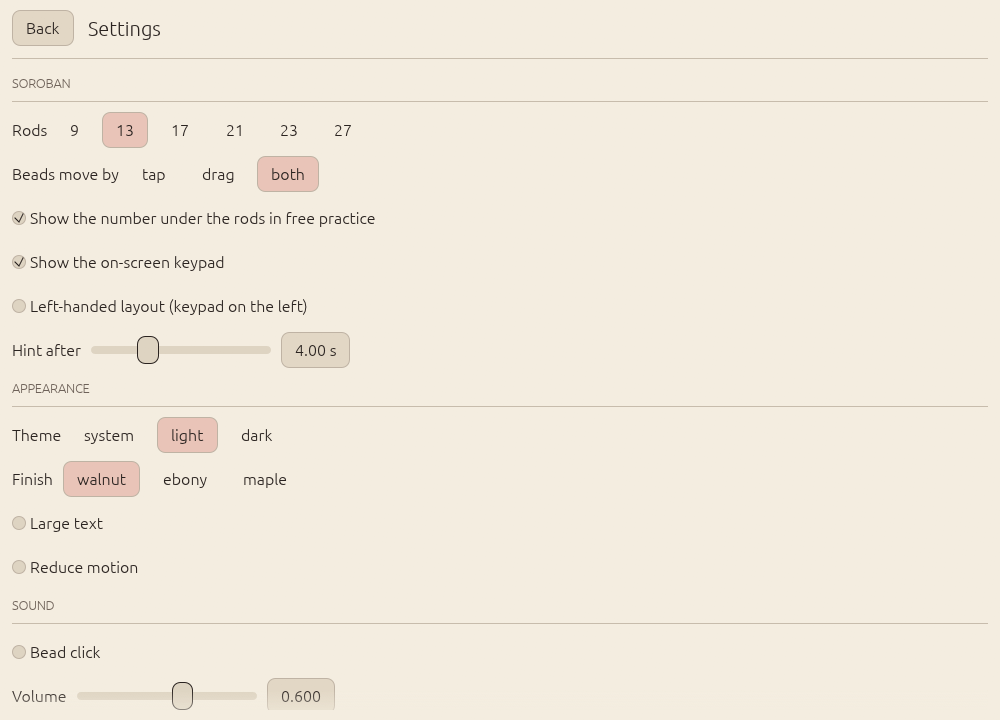
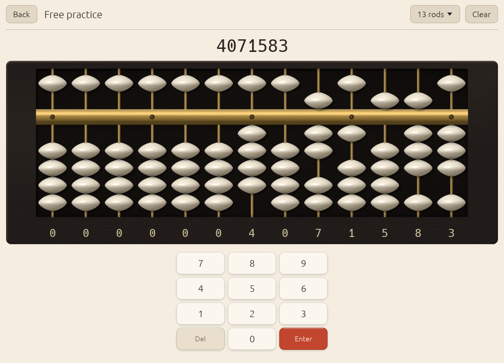
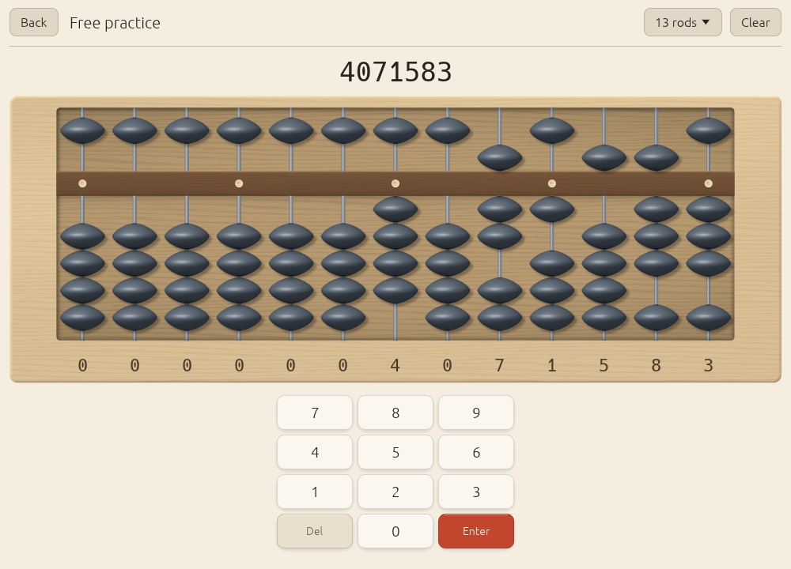

# Settings

Open **Settings** from the home screen. Every change is applied at once and
saved with your profile; the name in brackets is the field in the
[save file](save-file.md).

<picture>
  <source srcset="../screenshots/settings-dark.png" media="(prefers-color-scheme: dark)">
  
</picture>

## Soroban

| Setting | Choices | Default | What it does |
|---------|---------|---------|--------------|
| Rods (`rod_count`) | 9, 13, 17, 21, 23, 27 | 13 (9 on a new Android profile) | Rods on the free-practice soroban and the upper limit for drills. Drills use fewer when the problem needs fewer, so beads stay large on phones. |
| Beads move by (`input_mode`) | tap, drag, both | both | Tap moves a bead group in one go; drag lets beads follow the finger and snap on release. |
| Show the number under the rods in free practice (`show_numbers`) | on, off | on | The digit under each rod. Drills decide for themselves: a "read" item hides them, anzan hides them. |
| Show the on-screen keypad (`show_keypad`) | on, off | on | Off is comfortable with a keyboard. Items that need a typed answer always show it. |
| Left-handed layout (`left_handed`) | on, off | off | Puts the keypad on the left. |
| Hint after (`hint_delay_seconds`) | 1.5 to 10 s | 4 s | How long Abax waits after your last move before showing the next one in a drill. Guided practice in lessons always uses 1.5 s. |

## Appearance

| Setting | Choices | Default | What it does |
|---------|---------|---------|--------------|
| Theme (`theme`) | system, light, dark | system | Paper and ink, or the dark variant. "system" follows the operating system. |
| Finish (`finish`) | walnut, ebony, maple | walnut | The soroban's material. Walnut: lacquered walnut frame, bamboo rods, bone beads. Ebony: near-black frame, brass rods and beam, bone beads. Maple: pale maple frame, steel rods, slate beads. Vermilion stays the one accent in all three. |
| Large text (`large_text`) | on, off | off | Scales all text by 1.22. |
| Reduce motion (`reduce_motion`) | on, off | off | Beads jump to their new place instead of gliding, and the hint halo stays steady instead of pulsing. |

## Sound

| Setting | Choices | Default | What it does |
|---------|---------|---------|--------------|
| Bead click (`sound`) | on, off | off | A short synthesised click per bead group: a 2 ms noise burst into a decaying 1.8 kHz resonance, a little lower for the heaven bead. |
| Volume (`volume`) | 0 to 1 | 0.6 | Loudness of the click. |

Sound is not available on Android in this version; the settings screen says
so when there is no audio output.

## Flash anzan

The three free-flash settings, digits (`flash_digits`, default 1), numbers
(`flash_count`, default 5) and seconds per number (`flash_ms`, default
1000 ms), are set on the flash screen itself before each run and remembered
there. See [Anzan and flash anzan](anzan.md#free-flash).

## Data

- **Profile** shows the path of your save file.
- **Save now** writes it immediately (Abax also saves by itself within 5 seconds
  of a change, and when it closes).
- **Reset all progress** asks for confirmation, then deletes lesson progress,
  mastery and history. Your settings stay.

## About

The Abax version, and the average and 95th-percentile frame time over the
last 120 frames, which is useful in a bug report about performance.
